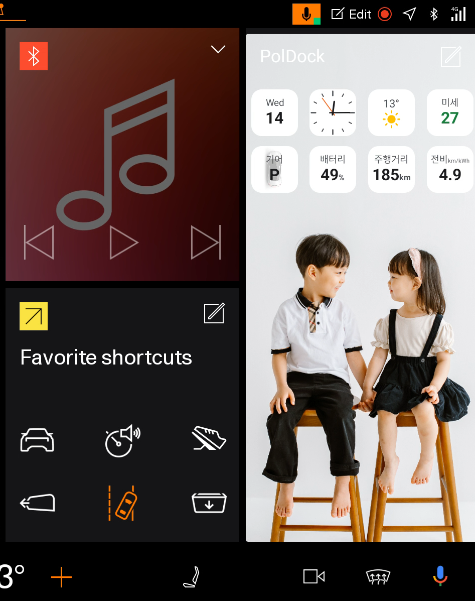

# PolDock

PolDock은 Polestar Android Automotive 화면 위에 위젯과 앱 바로가기를 표시하는 차량용 오버레이 독입니다.

홈 화면과 다른 앱 화면에 서로 다른 배치를 사용할 수 있으며, 가로·세로·그리드 모드와 차량 상태 위젯을 지원합니다. Polestar 공식 앱이 아닌 개인 사이드로드 프로젝트입니다.

<p align="center">
  
</p>

## 주요 기능

- 가로, 세로, 그리드 독 배치
- 홈 화면과 그 외 화면의 독 배치 분리
- 위젯과 바로가기의 드래그 순서 변경
- 독 크기와 불투명도 조절
- 그리드 위치 선택: 우상단, 우측 전체, 우하단
- 그리드 배경색과 사용자 사진 설정
- 사진 맞춤, 채움, 원본 크기 및 가로·세로 정렬
- 사진 여백에 단색 또는 블러 배경 적용
- OEM Favorite Apps 방식의 앱·미디어 바로가기 검색
- 트립 미터와 차량 설정 화면 바로가기
- 시동 후 독 자동 실행
- GitHub Releases 기반 업데이트 확인

## 위젯

- 날짜 및 월간 달력
- 디지털·아날로그 시계
- 날씨와 미세먼지
- 음악 앨범아트 및 재생 정보
- 기어
- 배터리 잔량
- 주행 가능 거리
- 속도
- 전비
- 외기 온도

차량 데이터 위젯은 차량 ROM의 권한과 제공 데이터에 따라 일부 값이 표시되지 않을 수 있습니다.

## 설치

1. [최신 Release](https://github.com/lamer0712/PolDock/releases/latest)에서 `PolDock-v*.apk`를 받습니다.
2. 차량의 파일 탐색기에서 APK를 선택해 설치합니다.
3. PolDock을 실행하면 독이 화면에 표시됩니다.
4. 필요한 경우 위치 권한과 알림 접근을 허용합니다.

기존 설치본을 업데이트하려면 APK의 패키지명과 서명이 기존 앱과 같아야 합니다. 출처를 알 수 없는 앱 설치 허용 방식은 차량 소프트웨어 버전에 따라 다를 수 있습니다.

## 사용 방법

- 독 손잡이를 드래그해 위치를 변경합니다.
- 독 손잡이를 두 번 눌러 편집창을 엽니다.
- 편집창에서 화면, 모드, 위젯, 바로가기를 설정합니다.
- 위젯과 바로가기는 핸들을 끌어 순서를 변경합니다.
- 그리드 모드에서는 페이지를 좌우로 넘길 수 있습니다.

홈 화면 프로필은 OEM 런처의 분할 홈 화면에서 사용됩니다. 전체 지도 화면과 일반 앱 화면에는 `그 외` 프로필이 적용됩니다.

## 업데이트

앱을 실행하면 GitHub의 최신 정식 Release를 확인합니다.

1. 새 버전이 있으면 알림과 독의 구름 아이콘으로 표시합니다.
2. 사용자가 확인하면 APK를 다운로드합니다.
3. 패키지명, 버전, 앱 서명을 검증합니다.
4. 검증이 끝나면 시스템 파일 탐색기를 엽니다.
5. 사용자가 APK를 직접 선택하고 설치를 승인합니다.

PolDock은 APK 설치를 직접 실행하지 않습니다. Android의 백그라운드 화면 실행 제한이나 차량 ROM 구성에 따라 다운로드 완료 알림을 눌러 파일 탐색기를 열어야 할 수 있습니다.

## 권한

| 권한 | 용도 |
| --- | --- |
| 다른 앱 위에 표시 | 독 오버레이 표시 |
| 알림 | 업데이트와 실행 상태 표시 |
| 위치 | 날씨 정보 조회 |
| 알림 접근 | 음악 앨범아트와 재생 정보 조회 |
| 차량 정보 | 속도, 기어, 배터리, 주행 거리, 외기 온도, 전비 위젯 |
| 부팅 완료 | 차량 시동 후 독 자동 실행 |
| 인터넷 | 날씨와 GitHub Release 확인 |
| 저장소(Android 9 이하) | 업데이트 APK 다운로드 |

## 빌드

요구 사항:

- JDK 17
- Android SDK 36

```bash
./gradlew testDebugUnitTest assembleRelease
```

빌드 결과는 다음 위치에 생성됩니다.

```text
app/build/outputs/apk/release/app-release.apk
```

버전과 GitHub 저장소는 `gradle.properties`에서 관리합니다.

```properties
poldock.githubRepository=lamer0712/PolDock
poldock.versionCode=19
poldock.versionName=1.3.15
```

현재 프로젝트의 release 빌드는 개인 사이드로드 편의를 위해 debug 서명을 사용합니다. 별도 환경에서 빌드한 APK는 서명이 달라 기존 배포본 위에 설치되지 않을 수 있습니다. 정식 배포 체계로 전환할 때는 전용 키와 안전한 서명 설정이 필요합니다.

## 릴리스

1. `versionCode`와 `versionName`을 올립니다.
2. 테스트와 release 빌드를 실행합니다.
3. 변경 사항을 커밋하고 푸시합니다.
4. `v{versionName}` 태그의 정식 GitHub Release를 만듭니다.
5. 같은 서명으로 빌드한 APK를 `PolDock-v{versionName}.apk` 이름으로 첨부합니다.

OTA 확인에는 Draft와 Pre-release가 아닌 최신 정식 Release가 사용됩니다.

## 주의 사항

- PolDock은 Polestar 또는 ECARX의 공식 소프트웨어가 아닙니다.
- OEM 인텐트와 차량 데이터 API는 차량 모델 및 소프트웨어 업데이트에 따라 달라질 수 있습니다.
- 운전 중에는 설정을 변경하거나 화면을 조작하지 마세요.
- 설치와 사용에 따른 책임은 사용자에게 있습니다.

## 개발자

로로아빠
